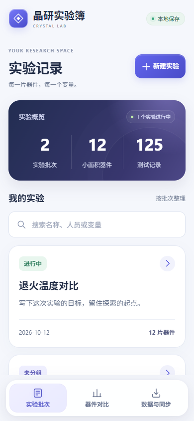
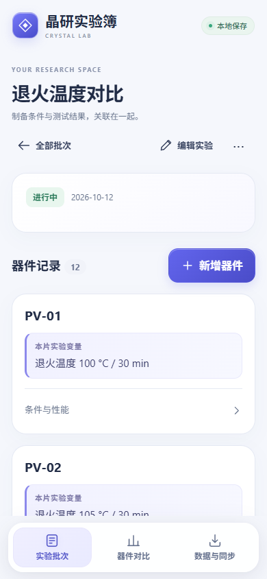
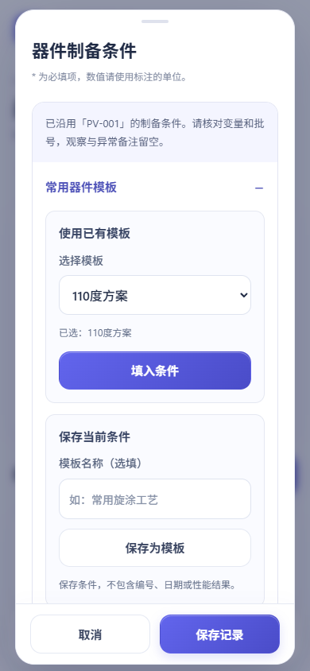

# 晶研实验簿

用于钙钛矿小面积电池制备的实验记录工具。支持 Android 离线记录，配套电脑端可通过浏览器查看、编辑，并在可信局域网内手动同步。

当前版本：**0.3.1**。安装包见 [GitHub Releases](https://github.com/mumium/perovskite-lab/releases)。

## 功能

- 按实验批次组织独立器件，记录变量、对照组、组分、溶液、旋涂、退火、环境和电极条件。
- 每个器件可记录多次性能测试：Voc、Jsc、FF、PCE、光强、面积、扫描条件和测试备注。
- 新建实验、器件自动带入最近保存的常用信息；支持命名模板和一键复制器件。
- 器件列表默认只展示编号和变量，其他条件及性能折叠查看。
- 导出条件关联 CSV、完整 JSON 备份；模板纳入备份及新版电脑端同步。
- 本地自动保存，无需注册账号；手机端启动无需联网。

  

截图均为测试示例，应用未预置实验数据。

## 开始使用

**安卓手机**：下载安装 `CrystalLab-0.3.1.apk`，支持 Android 10 及以上。升级时直接覆盖安装，不要卸载或清除数据。相同包名和签名才能保留原记录。

**Windows 电脑**：下载并解压完整套装，运行 `电脑端/CrystalLab-PC-0.3.1.exe`。程序会打开浏览器；保持程序窗口运行即可。更新电脑端时，在原目录替换 EXE，以沿用目录内的服务端数据与配对密钥。

**从源码运行电脑端**：安装 Python 3，在项目根目录执行：

```sh
python server.py
```

浏览器打开 `http://localhost:8765`。Windows 也可以双击 `启动电脑端.bat`。手机浏览器访问电脑地址需要电脑保持在线；它不能替代安卓安装版的离线启动。

## 记录与复用

1. 新建实验，记录人员、器件结构、实验目的、变量与对照。
2. 新建器件，以一个独立小面积电池为单位记录制备条件。优先沿用当前实验最近填写的器件条件；没有器件时沿用其他实验最近填写的条件。
3. 核对本次变量、批号、环境和编号。新建时日期、名称及编号自动更新，观察和异常备注默认留空。
4. 展开“条件与性能”可编辑器件、添加测试或一键复制器件。副本条件相同、编号不同，性能结果单独记录。
5. 表单顶部可保存当前条件为模板，或选择模板后点击“填入条件”。模板不包含 ID、名称/编号、日期、状态或测试结果。主动保存模板时会保留备注。
6. 对比条件与性能，定期导出 JSON 备份。CSV 一行对应一次测试，并包含对应的制备条件。

FF 使用百分数，例如输入 `80` 表示 80%。Voc 单位为 V，Jsc 为 mA/cm²，入射光功率为 mW/cm²。

计算 PCE (%) = Voc × Jsc × FF (%) / 入射光功率。填写了仪器 PCE 时优先显示该值，同时保留参数计算值；稳态 MPP 的实际效率应填写仪器 PCE，计算值不能替代稳态测量。

## 手机与电脑同步

两端连接同一可信 Wi-Fi。启动电脑端后，在两端“数据与同步”中填写电脑地址（如 `http://192.168.1.10:8765`）与电脑窗口显示的配对密钥，并分别点击同步。电脑浏览器记录不会自动写进服务端。

- 按记录 ID 合并，同 ID 的整条记录以本次提交端覆盖服务端。编辑前先同步，避免同时修改同一器件。
- 记录与模板的删除暂不传播，需要在另一端单独删除。
- 使用 0.3.0 及以上电脑端可同步模板；导入旧 JSON 备份不会清空现有模板。
- HTTP 未加密，仅在可信局域网使用，不要把服务映射到公网。

## 构建 Android 应用

需要 JDK 17、Android SDK / Build Tools 35。Gradle Wrapper 使用 Gradle 8.9，首次构建需要联网下载依赖。建议在不含中文的路径构建。

1. 用 Android Studio 打开 `android`，或复制 `android/local.properties.example` 为 `android/local.properties` 并填写 SDK 路径。
2. 在 `android` 目录执行：

```sh
# Windows
gradlew.bat assembleDebug

# macOS / Linux
sh gradlew assembleDebug
```

构建会自动将 `web` 文件复制进 APK assets。调试包位于 `android/app/build/outputs/apk/debug/`。

发布构建需要自己的签名配置：复制 `android/signing.properties.example` 为 `android/signing.properties`，填写本地密钥信息，然后执行 `assembleRelease lintRelease`。原已安装版本的覆盖更新必须使用原签名；私有签名密钥没有提交到仓库。请自行安全备份密钥与密码。

## 开发与检查

应用前端为原生 HTML/CSS/JavaScript，电脑服务只使用 Python 标准库。运行应用无需安装 Node.js；浏览器自动化测试才需要 Playwright。

```sh
node --check web/app.js
node --check web/presets.js
node test.cjs
python test_sync.py

# UI 流程检查
npm install
npx playwright install chromium
npm run test:ui
```

Windows 默认使用已安装的 Edge，否则使用 Playwright Chromium。也可通过 `PLAYWRIGHT_BROWSER_EXECUTABLE` 指定浏览器可执行文件。测试使用独立示例数据、临时目录和本机端口，完成后关闭测试服务及浏览器。

Android 发布包已通过构建、签名检查和浏览器尺寸流程检查。安卓真机安装、导出与跨设备网络仍需实际手机验证。

## 数据与文件

- 本地记录保存在 WebView / 浏览器存储中。卸载、清除应用数据或浏览器站点数据会丢失记录，请先备份。
- 服务端保存 `lab-data.json`，上次版本为 `lab-data.previous.json`，配对密钥为 `.pairing-key`。这些文件及实验导出文件应留在自己的设备上。
- 原始 J–V、EQE、XRD 等文件路径可写入备注，附件本体需要另外保留。
- 当前没有云端账号、附件上传、拍照、曲线解析或多人权限功能；工艺字段仅用于记录，不是制备配方建议。
- 仓库不包含真实实验数据、配对密钥、签名密钥、密码、本机路径配置或构建缓存。安装包通过版本发布页提供。

版本变更见 [CHANGELOG.md](CHANGELOG.md)。
